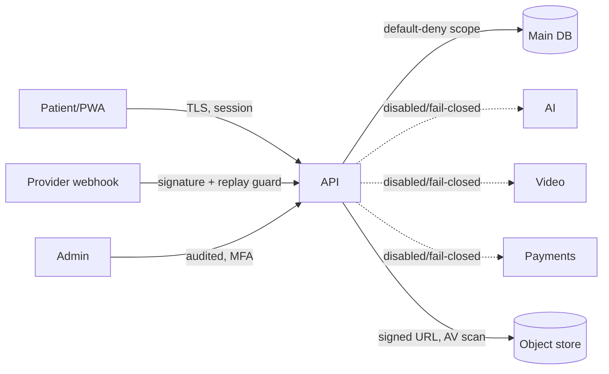

# Kaya threat model and data-flow map (Phase 8)

Evidence date 14 September 2026. Trust boundaries, sensitive flows, abuse cases,
and processor exposure, made explicit before more clinical capability is added.
Contains **no real secrets, credentialed endpoints, patient examples, or
production identifiers** (test-guarded). Diagrams are not mitigation by
themselves; high-risk threats are bound to controls, tests, or time-bound risk
records (see [risk register](KAYA_RISK_REGISTER.md)).

## Actors

Patient/representative; caregiver; minor (via authorized representative); doctor;
nurse; pharmacist; credentialing reviewer; support agent; organization admin;
platform admin; release board; external processors (AI, video, payments,
credential verification, email/SMS, object storage, device ingest); anonymous
internet user; suspended user; compromised provider/insider.

## Sensitive data categories

| Category | Source | Purpose | Destination | Processor | Retention rule | Authorized actor path |
| --- | --- | --- | --- | --- | --- | --- |
| Account identity | Registration | Authentication | Main DB (`User`) | none (self-hosted) | Account lifetime + legal min | Self; admin (audited) |
| Credentials (clinician) | Clinician upload | Verify licence | Private object store | Credential verifier (disabled) | Per credentialing policy | Reviewer; owning clinician |
| Consent records | Consent flow | Lawful basis | Main DB (versioned) | none | Retained + withdrawal log | Self; DPO (audited) |
| Triage inputs | Patient | Routing | Main DB | none (no AI diagnosis) | Episode + retention rule | Self; assigned clinician |
| Photos | Patient camera | Clinical context | Private object store | AV scan (Phase 29) | Episode retention | Self; assigned clinician |
| Device readings | Device/manual | Monitoring | Main DB | Device adapter (Phase 31) | Episode retention | Self; assigned clinician |
| Booking | Patient | Scheduling | Main DB | none | Episode retention | Self; assigned clinician/clinic |
| Video session | Runtime | Teleconsult | Video provider (disabled) | Video (BAA required) | No recording by default | Participants only |
| Clinical notes | Clinician | Record of care | Main DB (signed, Phase 26) | none | Legal medical-record retention | Author; care team (scoped) |
| Prescriptions | Clinician | Treatment | Main DB / pharmacy (Phase 27) | none (no own e-Rx yet) | Legal retention | Prescriber; patient |
| Messages | Participants | Care comms | Main DB | none | Episode retention | Thread participants |
| Payments | Patient | Billing | Payment provider (disabled) | Payment (PCI) | Tokenized ref only | Self; finance (aggregate) |
| Analytics | Aggregation | Operations | Main DB (aggregate) | none | De-identified | Clinic/ops (no individual clinical to employers) |
| Backups | System | Recovery | Encrypted store (Phase 34) | cloud KMS | DR policy | Infra (break-glass, audited) |
| Support tickets | User | Assistance | Main DB | email (disabled) | Support policy | Support (no individual clinical unless scoped) |
| Data-rights requests | User | Legal rights | Main DB | none | Legal | Self; DPO |

## Trust boundaries

Internet ↔ web/PWA; web/PWA ↔ API; API ↔ main DB; API ↔ accounts DB; API ↔ each
external processor (each a distinct boundary with its own adapter); mobile device
↔ API; browser storage ↔ app; object store ↔ signed URLs; webhook sender ↔
webhook receiver; admin plane ↔ clinical data; backup/KMS ↔ restore.

## Data-flow (representative)

## Threat catalog (each boundary: named threat + preventive + detective control)

| Threat | Boundary | Preventive control | Detective control | Owner | Residual / link |
| --- | --- | --- | --- | --- | --- |
| Account takeover | web↔API | MFA, session families, rate limit | Auth anomaly logs | Security | R08; Phase 13 |
| Privilege escalation / self-assign role | web↔API | Server-side role provisioning; no client role trust | Authz-denial audit | Security | R08; Phase 14 |
| Credential fraud | reviewer plane | Human decision + separation of duties (governance) | Atomic audit event | Credentialing | Phase 17 |
| Cross-tenant / IDOR | API↔DB | Default-deny scope by org/episode/role/purpose | Access audit + negative tests | Security | Phase 14 |
| Consent bypass | API↔DB | Server-owned versioned consent; purpose check | Consent audit | DPO | Phase 15 |
| Deep-link / invite leakage | email↔user | Short-lived, single-use, scoped tokens | Token-use logs | Security | Phase 16 |
| Webhook forgery / replay | provider↔API | Signature verify + idempotency + nonce | Replay/reject metrics | Integrations | Phase 25/39 |
| Booking race | API↔DB | Transactional + idempotency + unique constraints | Conflict metrics | Backend | Phase 23 |
| AI prompt injection / egress | API↔AI | AI disabled/fail-closed; no clinical context egress; kill switch | Egress deny logs | Privacy/Security | R03; Phase 30 |
| Malicious file | patient↔object store | Magic-byte + AV quarantine | Quarantine events | Security | Phase 29 |
| Insider / admin abuse | admin↔clinical | Least privilege, MFA, break-glass | Admin action audit | Security | Phase 37 |
| Denial of service | internet↔API | Rate limit, timeouts, bounded work | Availability SLO alerts | Ops | Phase 37 |
| Unlawful cross-border transfer | API↔processor | Data-residency controls; provider disabled | Transfer inventory | DPO | R09; Phase 9/10 |

## Abuse cases

Minor/representative acting beyond authority; caregiver over-access; employer
seeking individual clinical data (denied — aggregate only); support agent
over-reach; reviewer approving own evidence (blocked by separation of duties);
clinician acting outside privileges/scope; suspended user retaining access;
compromised provider returning malicious data. Each maps to a control above and a
negative test in the relevant capability phase.

## Change trigger

This model MUST be revised whenever a **processor, data category, role,
jurisdiction, or trust boundary** changes. A change to any of those without a
threat-model update is a release-blocking gap.

## No-mitigation-by-diagram

High-risk threats (account takeover, privilege escalation, cross-tenant/IDOR,
consent bypass, webhook forgery, AI egress, malicious file) are each tied above
to a capability phase that adds preventive controls **and negative tests**, or to
a time-bound entry in the risk register. A diagram alone never closes a threat.
